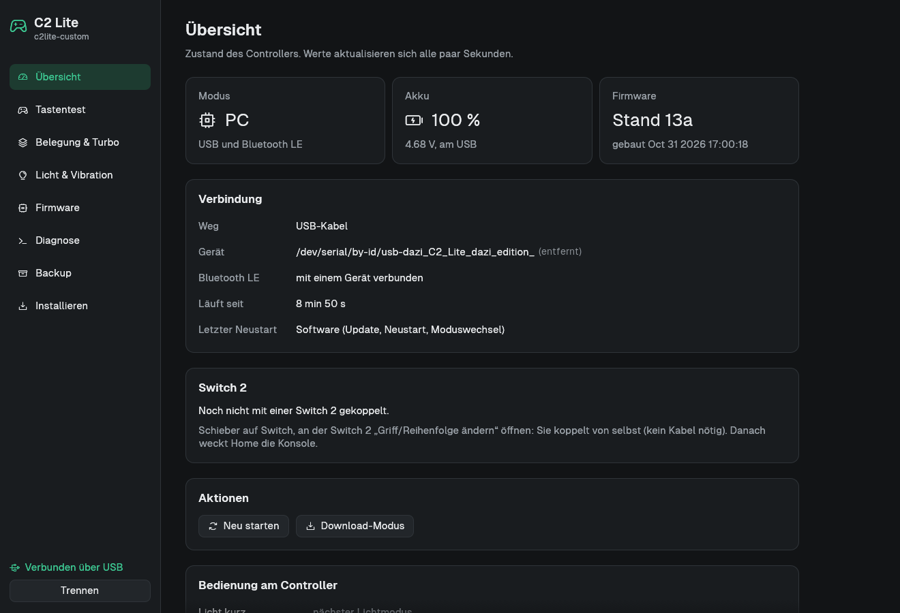
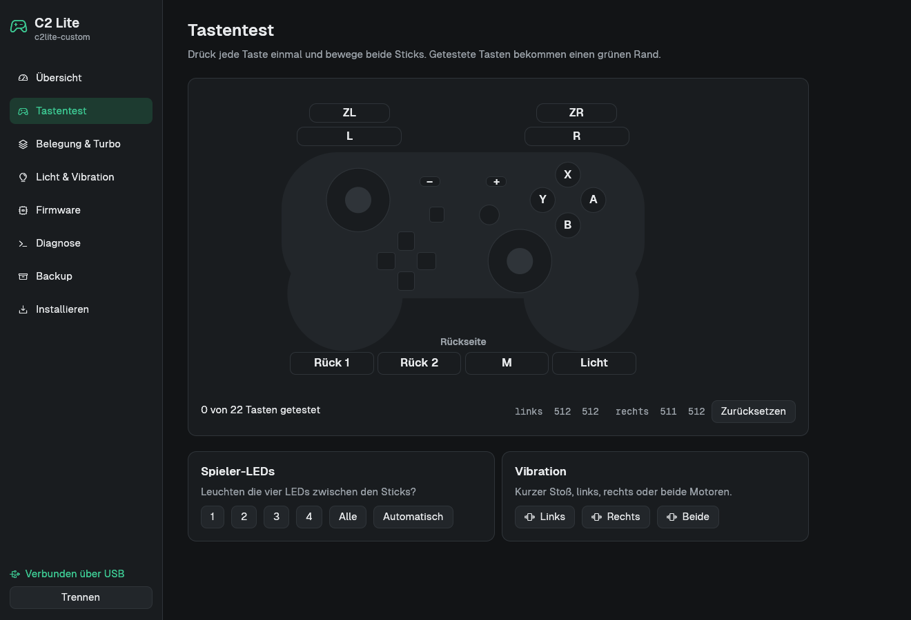
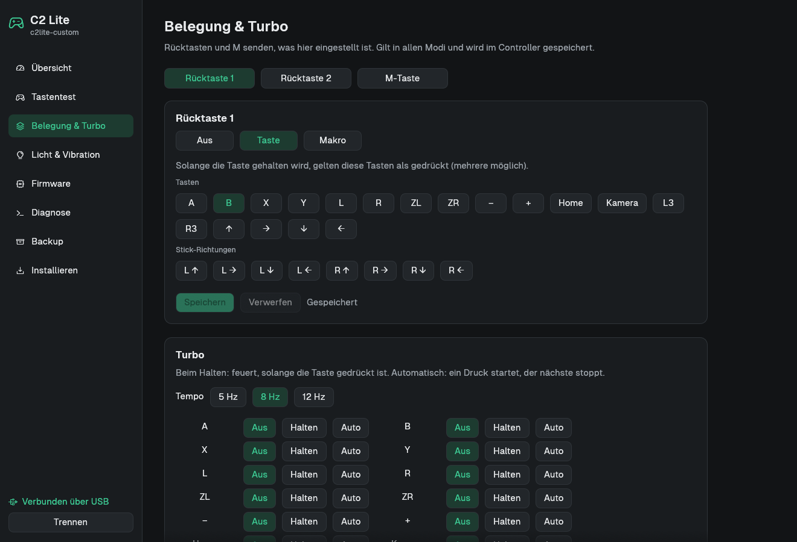
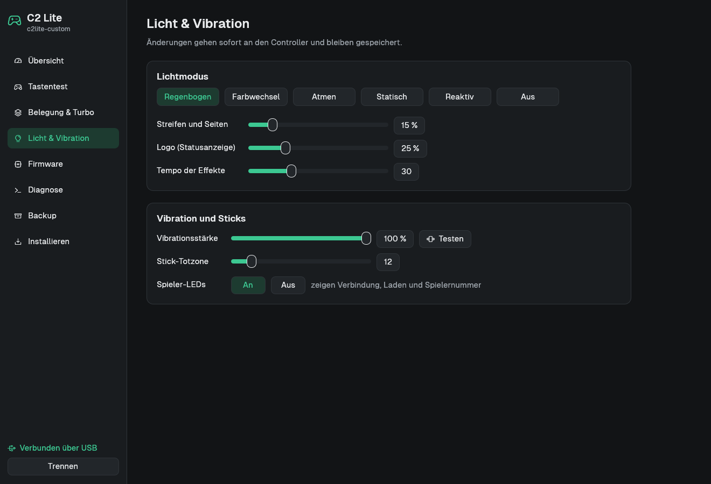
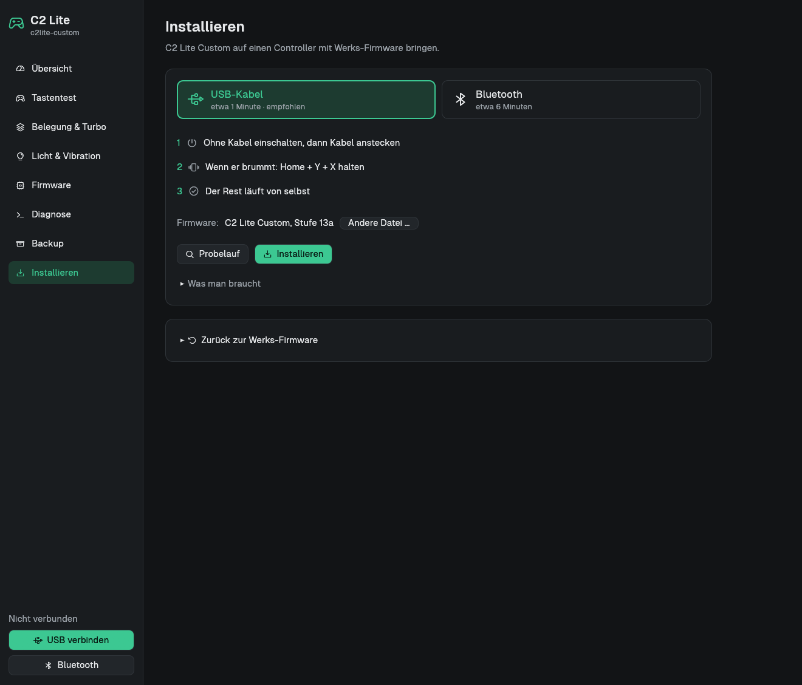
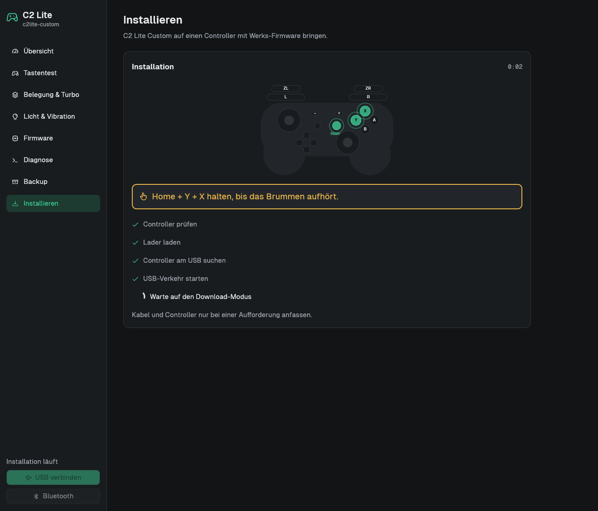
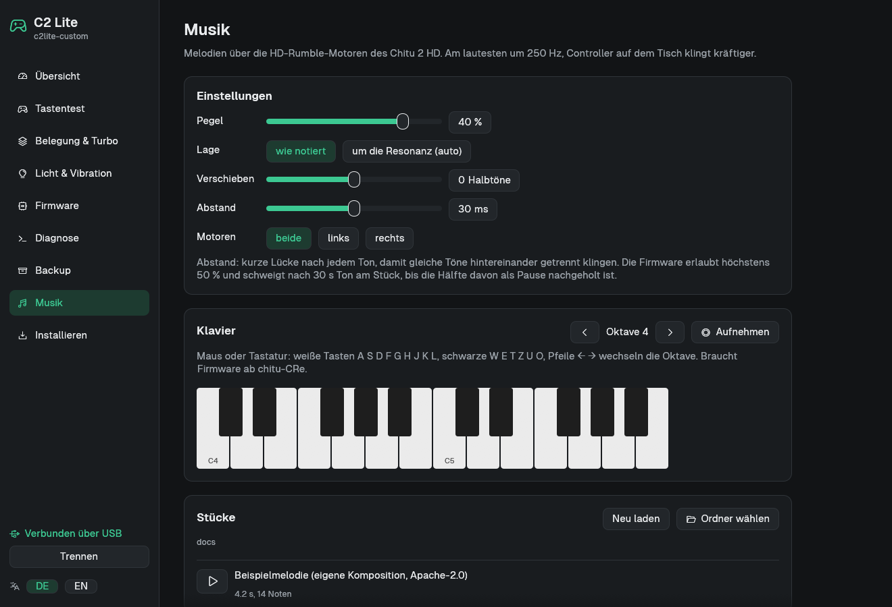

# C2 Lite Custom

Replacement firmware for the Mobapad C2 Lite (Jieli BR23) and the program `c2lite-custom` to install and configure it.
An experimental variant exists for the Mobapad Chitu 2 HD (see [below](#chitu-2-hd-experimental)).

Deutsche Version: [`README.md`](README.md)

## Why

With the factory firmware the controller did not work on Linux over USB (firmware bug, only with the kernel parameter
`usbcore.quirks=2345:e06e:i`) or Bluetooth (pairing is rejected). On the Switch 2 it shows up as an old Switch 1
controller and cannot wake the console.

With this firmware:

- PC: as an Xbox controller with rumble, over USB and over Bluetooth LE
- Switch 2: over Bluetooth as a Pro Controller 2; Home wakes the console, the controller powers off 30 s after the
  console goes to standby
- Switch wired as a Pro Controller
- Back buttons, turbo, macros, lighting, auto power-off as before, configured with `c2lite-custom` instead of the app
- Updates over USB or Bluetooth

## What `c2lite-custom` looks like

The program speaks English and German: DE/EN switch at the bottom left, it starts in the system language
(`C2LITE_SPRACHE=en` or `de` overrides). The pictures show the German version.

| | |
|---|---|
|  |  |
| Overview (serial number and address removed) | Button test |
|  |  |
| Mapping & turbo | Light & rumble |
|  |  |
| Installing (USB cable or Bluetooth) | Installing: hold Home + Y + X |

## Installing on the C2 Lite (Linux)

Requirements: Linux on x86_64, a USB data cable, internet for the first run and `c2lite-custom`: prebuilt under
[Releases](https://github.com/dazi-web/mobapad-c2lite/releases) (glibc ≥ 2.31, e.g. Debian 11, Ubuntu 20.04 and
newer) or built yourself with `cargo build --release` in [`c2lite-custom/`](c2lite-custom/). The firmware
[`release/jl_isd.bin`](release/) is built into the program (checksums in `release/SHA256SUMS`); a file of your own
can be chosen instead (building it yourself: see [`docs/FIRMWARE.en.md`](docs/FIRMWARE.en.md)).

**Via the USB cable (recommended):**

1. Start `c2lite-custom`, page "Installieren", way "USB-Kabel" (firmware: built in).
2. First the dry run ("Probelauf"): opens the download mode and backs up the flash, writes nothing.
3. Switch on the controller **without the cable** (slider on PC, Home), then plug in the cable.
4. When the controller buzzes lightly: hold **Home + Y + X** until the buzzing stops (about 2 s). The program backs
   up the whole flash to `~/c2lite-sicherung/`, writes the firmware, reads it back and restarts.

Command line: `c2lite-custom installieren --usb [--probelauf] [own-jl_isd.bin]`. Background:
[`docs/WERKS-DOWNLOAD.en.md`](docs/WERKS-DOWNLOAD.en.md).

**Via Bluetooth** (needs Bluetooth on the computer; way "Bluetooth"):

1. Dry run: pairs with the controller once, changes nothing.
2. Install: put the controller into pairing mode without a cable. The program transfers a small bridge over the
   official update path (4 to 6 minutes).
3. When asked, plug in the USB cable. Continue as above.

Afterwards: slider on PC for the computer, on Switch for the Switch. From firmware stage 14: hold **Minus** while sliding to Switch = Switch 1,
**Plus** = Switch 2 (logo blinks cyan once or twice, the choice is stored). Pair once on the Switch under
"Change Grip/Order". Installing clears the controller's settings storage, so the program removes this computer's
old Bluetooth pairing with "C2 Lite dazi" itself. Pair again to use Bluetooth on the PC.

Installing is not possible on Windows. The controller should work there as an Xbox controller without drivers; this
is untested.

## Chitu 2 HD (experimental)

The Mobapad Chitu 2 HD (over Bluetooth "Mobapad-Pro2-HD") has the same chip but a different board: the sticks come
from a separate chip, the vibration from two linear motors on the audio DAC ("HD rumble"). It has its own build variant
of the firmware (`sdk-arbeit/chitu-sdk-aenderungen.patch`, ready-made in [`release/chitu/`](release/chitu/)).
The C2 Lite firmware does **not** fit the Chitu and vice versa; the program checks this before every write.

Working (tested on one unit):

- PC: Xbox controller over USB (Linux without kernel parameter) and Bluetooth LE, all buttons, both sticks,
  L2/R2 digital (as with the factory firmware)
- Rumble from games on both linear motors (left motor 160 Hz, right 320 Hz, as with the factory firmware)
- Melodies on the motors: `c2lite-custom musik <file>` or the "Musik" page in the program (note format below),
  which also has a piano (mouse or keyboard, recording to a note file)
- Lights: player LEDs (player 1 when connected, all four blink while charging), the logo as a status light and the
  5 LEDs in the charging dock: a light trail when docked, a bar with the charge level while charging, the rainbow
  wave from the factory firmware when full; while music plays, the dock lights up with the notes. The controller
  sends the dock light through the contacts; the dock needs a power supply (a laptop USB port was not enough in tests).
- Updates over the USB cable, way back to the factory firmware

Missing so far: Switch / Switch 2, motion sensor, NFC. If the controller restarts
unexpectedly, the program saves the log to `~/.cache/c2lite-custom/` on the next connection.

Install (Linux only, USB cable only):

```
c2lite-custom installieren release/chitu/jl_isd.bin --usb
```

Unplug the cable, wait until the Chitu is off, switch it on without the cable with a short press on Home, plug in the
cable. When it rumbles in a rhythm, hold Home + Y + X until the rumbling stops. The program backs up the whole memory to
`~/c2lite-sicherung/werk-sicherung-*.bin`, detects the board, writes, reads back and restarts.

- Update: `c2lite-custom update release/chitu/db_update_data.bin` (or the "Firmware" page)
- Back to the factory firmware: `c2lite-custom werk-zurueck ~/c2lite-sicherung/werk-sicherung-<time>.bin`
- Rescue without opening: Home + Y + X for 3 s with a PC on the cable starts the ROM download mode; Home for 10 s
  restarts. Plug the cable directly into the computer, not through a USB hub: through a hub the download mode did not
  enumerate in tests and only came back after a power loss. If the firmware fails to start stably several times in a row, it waits instead of restarting in a loop
  (so far this guard has only been triggered on the C2 Lite with the same firmware).
- With a C2 Lite and a Chitu plugged in at the same time, the command line asks for `--port`; the program window has a
  selector at the bottom left.



**Note on music and vibration:** Long or loud tones stress the motors, the mechanics and the battery more than normal
rumble. The firmware limits the level (50 %) and the duration (30 s in a row); whether that is enough for every unit is
not verified. Damage to the motors or the controller is possible; use at your own risk.

Note format for `musik`: name + octave (`A3`, `C#4`, `H3` = B3) or a frequency in Hz, duration `:ms`, rest `P`,
comment `#`, e.g. [`docs/beispiel-melodie.txt`](docs/beispiel-melodie.txt). It sounds clearest between about 250 and
700 Hz; put the controller on a table.

## Risks

Replacing firmware can make the controller unusable. It happened once during development. Precautions (C2 Lite; for
the Chitu's rescue see above):

- Before the first write the whole flash is backed up. It allows going back to the factory firmware
  (page "Installieren", "Zurück zur Werks-Firmware"; tested on the device).
- Everything written is read back and compared; downloaded files are checked by checksum.
- Updates go to the second flash bank. If an update is interrupted, the old firmware starts.
- The chip has a loader mode in ROM that no firmware can overwrite. With this firmware: hold Home and Minus for 5 s
  with the USB cable plugged in directly at the computer (through a USB hub the loader mode did not enumerate in tests).
- If nothing starts any more, only an ESP32-C6 as a rescue sender helps ([`c6-rettung/`](c6-rettung/)); the controller
  has to be opened for that.

Do not unplug the cable or switch the controller off while writing. Keep the backup from `~/c2lite-sicherung/`; it
only fits this one controller. The warranty is probably void afterwards. Use at your own risk.

## How it was made

The project was built in a few days together with Claude (Anthropic, via Claude Code) as co-author. It was tested on one
C2 Lite, one Chitu 2 HD and one Switch 2. Read the code before trusting it; bug reports are welcome.

## Source code and license

Own code (firmware modules, SDK changes, `c2lite-custom`, tools): Apache-2.0, see [`LICENSE`](LICENSE). The firmware
is based on the public [Jieli SDK](https://github.com/Jieli-Tech/fw-AC63_BT_SDK) (also Apache-2.0); Jieli ships the
Bluetooth stack only precompiled. Mobapad firmware is not in the repository; the tools download it from Mobapad's
server when needed. Fonts in `c2lite-custom/assets/fonts/`: Geist, SIL Open Font License. The Bluetooth report
descriptor of the Xbox Wireless Controller comes from
[ESP32-BLE-CompositeHID](https://github.com/Mystfit/ESP32-BLE-CompositeHID) (MIT, © lemmingDev and contributors).

## Documentation

- [`docs/FIRMWARE.en.md`](docs/FIRMWARE.en.md): features, usage, building, commands
- [`docs/PRO-CONTROLLER-2.en.md`](docs/PRO-CONTROLLER-2.en.md): the Switch 2 Pro Controller 2 mode and what you need
- [`docs/WERKS-DOWNLOAD.en.md`](docs/WERKS-DOWNLOAD.en.md): USB download mode of the stock firmware (Home + Y + X),
  without the Bluetooth bridge and without an ESP32
  to know to build your own

The program is in English and German; tools and most documents are in German. Commands and file names are German
words (`installieren` = install, `sicherung` = backup, `werk` = factory); `c2lite-custom help` explains them in English.

Folders: `c2lite-custom/` program, `sdk-arbeit/sdk-aenderungen.patch` firmware (changes to the Jieli SDK),
`sdk-arbeit/chitu-sdk-aenderungen.patch` the same for the Chitu 2 HD, `release/` prebuilt firmware (`release/chitu/`
for the Chitu), `werkzeuge/` building, packing, download mode, `c6-rettung/` rescue sender.

Thanks to [kagaimiq](https://github.com/kagaimiq) (jl-uboot-tool and Jieli documentation),
[ndeadly](https://github.com/ndeadly/switch2_controller_research) (Switch 2 protocol) and the ESP32 projects listed in
[`docs/PRO-CONTROLLER-2.en.md`](docs/PRO-CONTROLLER-2.en.md).
