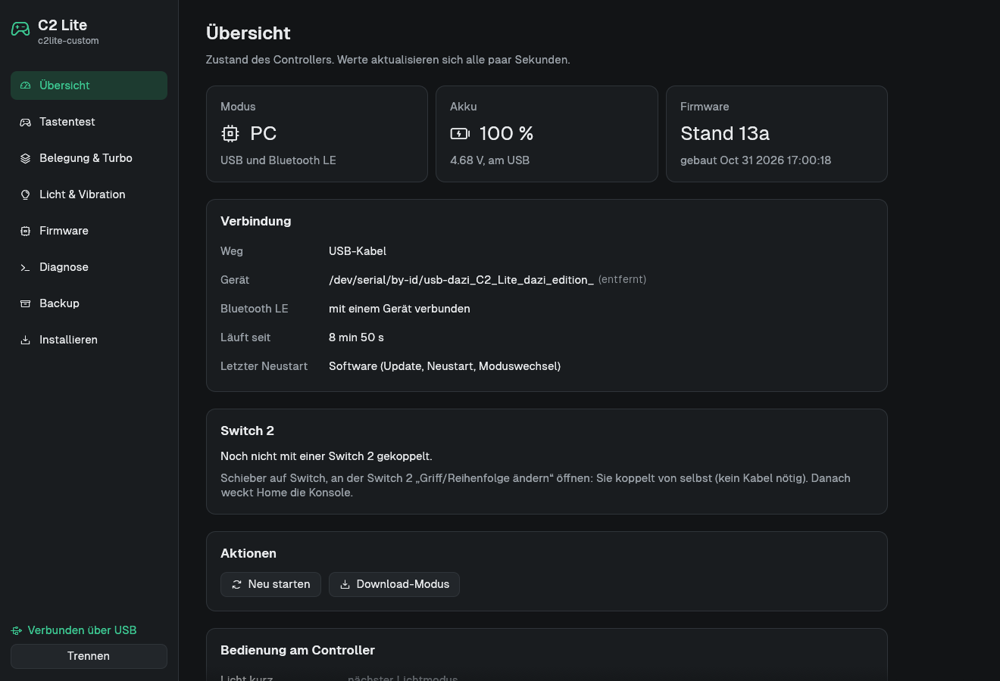
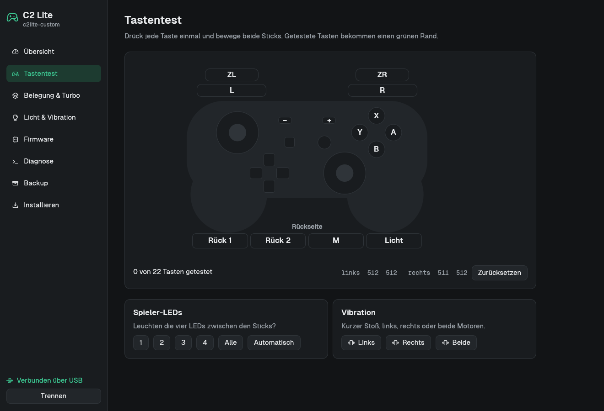
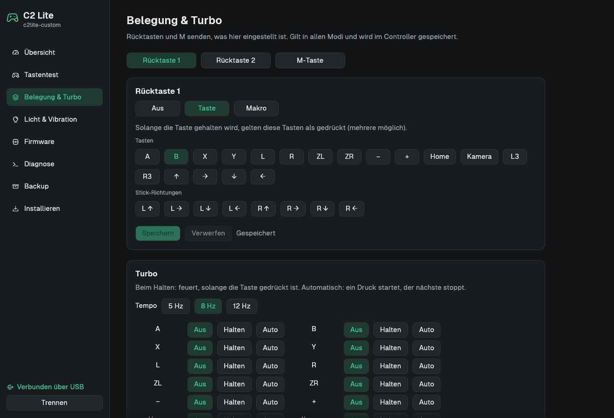
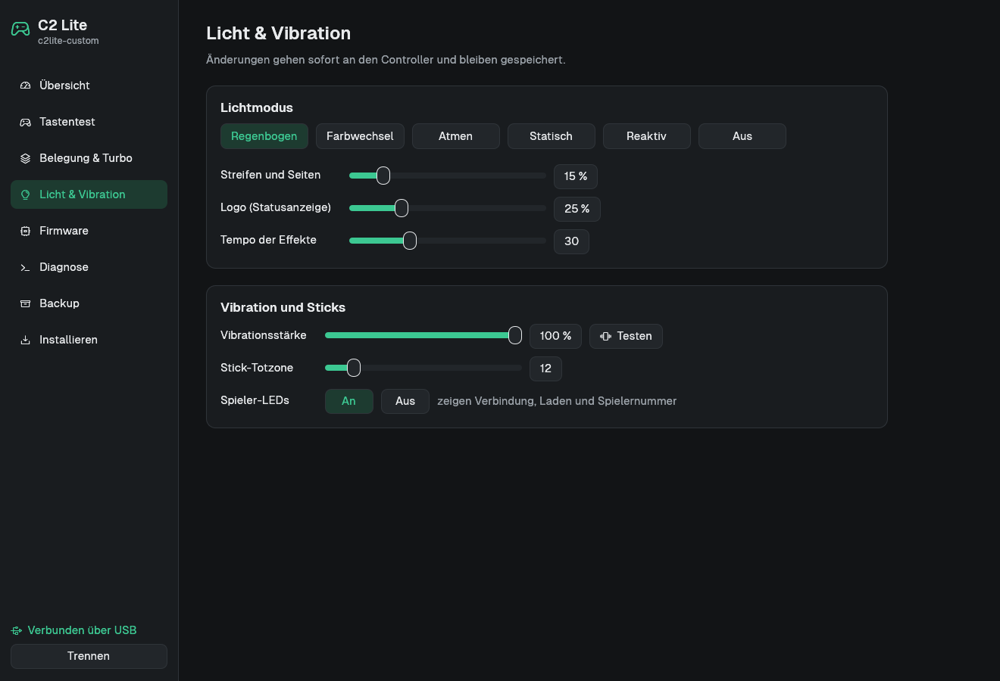
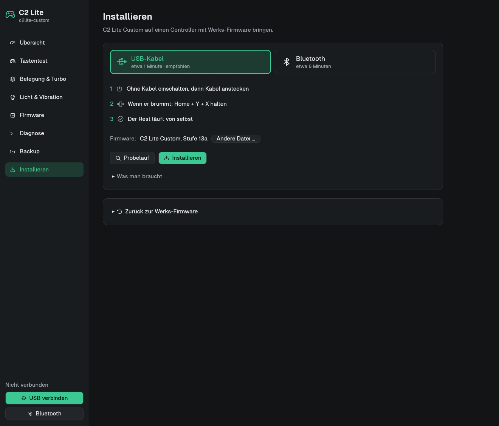
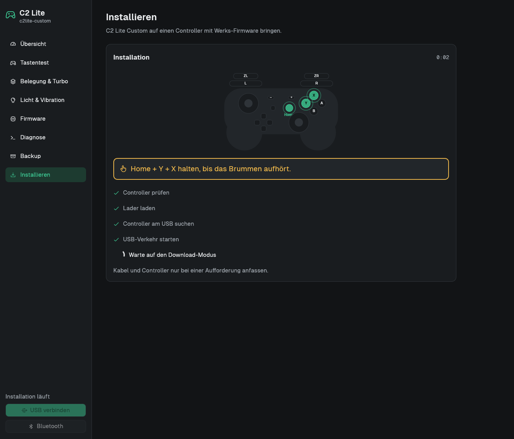

# C2 Lite Custom

Replacement firmware for the Mobapad C2 Lite (Jieli BR23) and the program `c2lite-custom` to install and configure it.

Deutsche Version: [`README.md`](README.md)

## Why

With the factory firmware the controller did not work on Linux over USB (firmware bug, only with the kernel parameter
`usbcore.quirks=2345:e06e:i`) or Bluetooth (pairing is rejected). On the Switch 2 it shows up as an old Switch 1
controller and cannot wake the console.

With this firmware:

- PC: as an Xbox controller with rumble, over USB and over Bluetooth LE
- Switch 2: over Bluetooth as a Pro Controller 2; Home wakes the console, the controller powers off 30 s after the
  console goes to standby
- Switch wired as a Pro Controller
- Back buttons, turbo, macros, lighting, auto power-off as before, configured with `c2lite-custom` instead of the app
- Updates over USB or Bluetooth

## What `c2lite-custom` looks like

The program is in German.

| | |
|---|---|
|  |  |
| Overview (serial number and address removed) | Button test |
|  |  |
| Mapping & turbo | Light & rumble |
|  |  |
| Installing (USB cable or Bluetooth) | Installing: hold Home + Y + X |

## Installing (Linux)

Requirements: Linux on x86_64, a USB data cable, internet for the first run and `c2lite-custom`: prebuilt under
[Releases](https://github.com/dazi-web/mobapad-c2lite/releases) (glibc ≥ 2.31, e.g. Debian 11, Ubuntu 20.04 and
newer) or built yourself with `cargo build --release` in [`c2lite-custom/`](c2lite-custom/). The firmware
[`release/jl_isd.bin`](release/) is built into the program (checksums in `release/SHA256SUMS`); a file of your own
can be chosen instead (building it yourself: see [`docs/FIRMWARE.en.md`](docs/FIRMWARE.en.md)).

**Via the USB cable (recommended, new since 2026-10-31):**

1. Start `c2lite-custom`, page "Installieren", way "USB-Kabel" (firmware: built in).
2. First the dry run ("Probelauf"): opens the download mode and backs up the flash, writes nothing.
3. Switch on the controller **without the cable** (slider on PC, Home), then plug in the cable.
4. When the controller buzzes lightly: hold **Home + Y + X** until the buzzing stops (about 2 s). The program backs
   up the whole flash to `~/c2lite-sicherung/`, writes the firmware, reads it back and restarts.

Command line: `c2lite-custom installieren --usb [--probelauf] [own-jl_isd.bin]`. Background:
[`docs/WERKS-DOWNLOAD.en.md`](docs/WERKS-DOWNLOAD.en.md).

**Via Bluetooth** (needs Bluetooth on the computer; way "Bluetooth"):

1. Dry run: pairs with the controller once, changes nothing.
2. Install: put the controller into pairing mode without a cable. The program transfers a small bridge over the
   official update path (4 to 6 minutes).
3. When asked, plug in the USB cable. Continue as above.

Afterwards: slider on PC for the computer, on Switch for the Switch 2. Pair once on the Switch 2 under
"Change Grip/Order".

Installing is not possible on Windows. The controller should work there as an Xbox controller without drivers; this
is untested.

## Risks

Replacing firmware can make the controller unusable. It happened once during development. Precautions:

- Before the first write the whole flash is backed up. It allows going back to the factory firmware
  (page "Installieren", "Zurück zur Werks-Firmware"; tested on the device).
- Everything written is read back and compared; downloaded files are checked by checksum.
- Updates go to the second flash bank. If an update is interrupted, the old firmware starts.
- The chip has a loader mode in ROM that no firmware can overwrite. With this firmware: hold Home and Minus for 5 s
  with the USB cable plugged in.
- If nothing starts any more, only an ESP32-C6 as a rescue sender helps ([`c6-rettung/`](c6-rettung/)); the controller
  has to be opened for that.

Do not unplug the cable or switch the controller off while writing. Keep the backup from `~/c2lite-sicherung/`; it
only fits this one controller. The warranty is probably void afterwards. Use at your own risk.

## How it was made

The project was built in a few days together with Claude (Anthropic, via Claude Code) as co-author. It was tested on one controller and
one Switch 2. Read the code before trusting it; bug reports are welcome.

## Source code and license

Own code (firmware modules, SDK changes, `c2lite-custom`, tools): Apache-2.0, see [`LICENSE`](LICENSE). The firmware
is based on the public [Jieli SDK](https://github.com/Jieli-Tech/fw-AC63_BT_SDK) (also Apache-2.0); Jieli ships the
Bluetooth stack only precompiled. Mobapad firmware is not in the repository; the tools download it from Mobapad's
server when needed. Fonts in `c2lite-custom/assets/fonts/`: Geist, SIL Open Font License. The Bluetooth report
descriptor of the Xbox Wireless Controller comes from
[ESP32-BLE-CompositeHID](https://github.com/Mystfit/ESP32-BLE-CompositeHID) (MIT, © lemmingDev and contributors).

## Documentation

- [`docs/FIRMWARE.en.md`](docs/FIRMWARE.en.md): features, usage, building, commands
- [`docs/PRO-CONTROLLER-2.en.md`](docs/PRO-CONTROLLER-2.en.md): the Switch 2 Pro Controller 2 mode and what you need
- [`docs/WERKS-DOWNLOAD.en.md`](docs/WERKS-DOWNLOAD.en.md): USB download mode of the stock firmware (Home + Y + X),
  without the Bluetooth bridge and without an ESP32
  to know to build your own

The program, tools and most documents are in German; commands and file names are German words
(`installieren` = install, `sicherung` = backup, `werk` = factory).

Folders: `c2lite-custom/` program, `sdk-arbeit/sdk-aenderungen.patch` firmware (changes to the Jieli SDK),
`release/` prebuilt firmware, `werkzeuge/` building, packing, download mode, `c6-rettung/` rescue sender.

Thanks to [kagaimiq](https://github.com/kagaimiq) (jl-uboot-tool and Jieli documentation),
[ndeadly](https://github.com/ndeadly/switch2_controller_research) (Switch 2 protocol) and the ESP32 projects listed in
[`docs/PRO-CONTROLLER-2.en.md`](docs/PRO-CONTROLLER-2.en.md).
