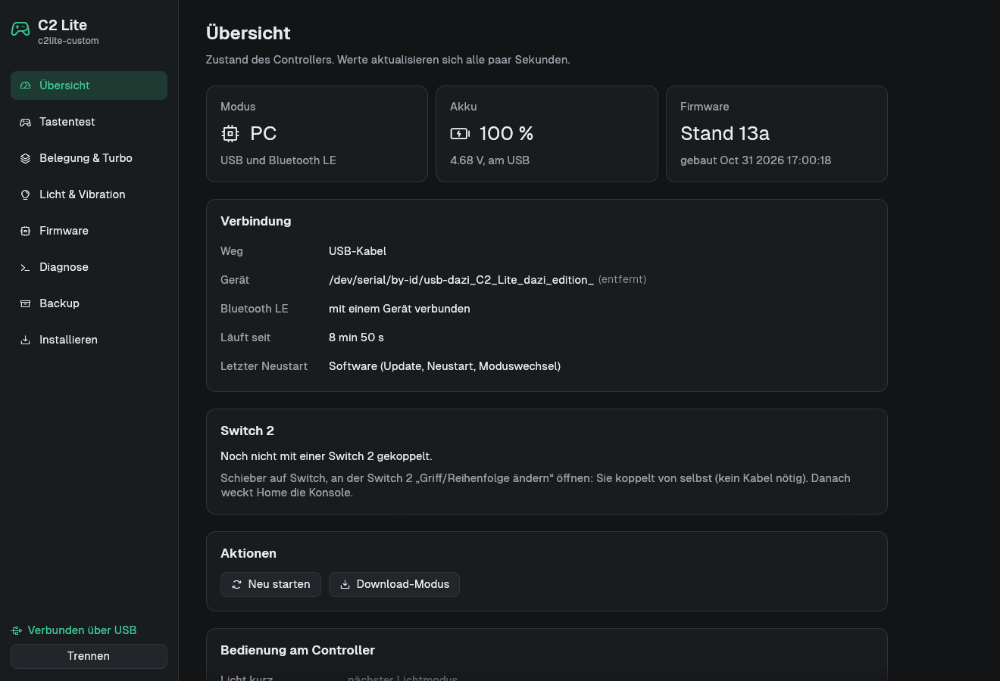
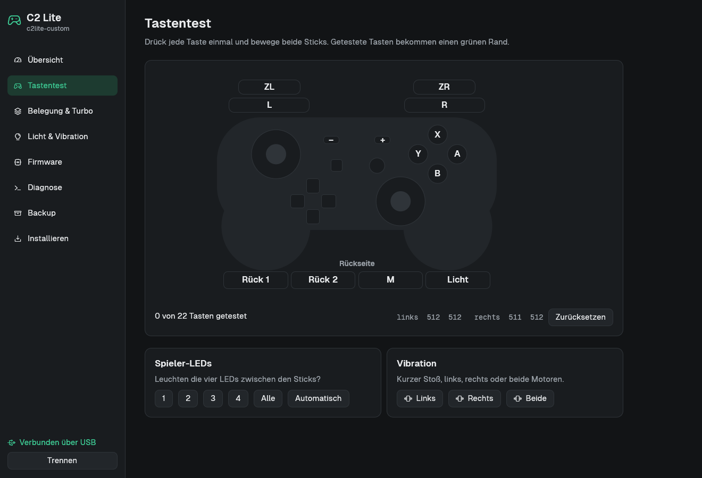
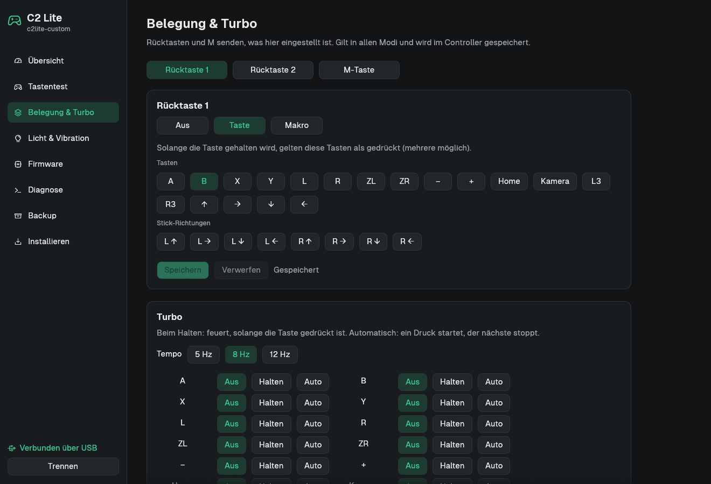
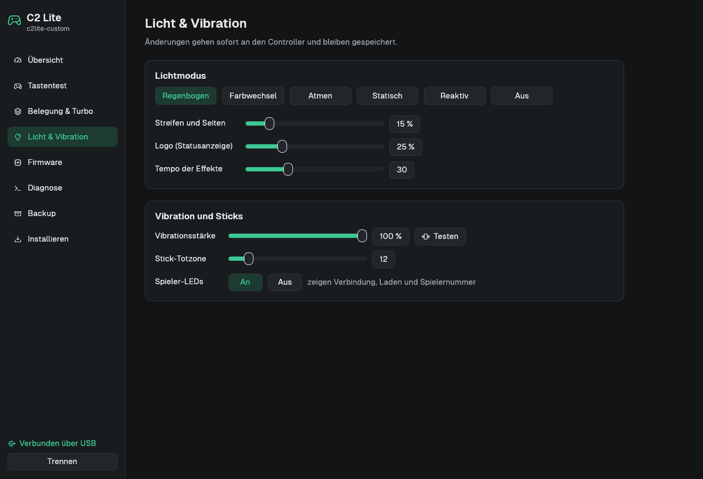
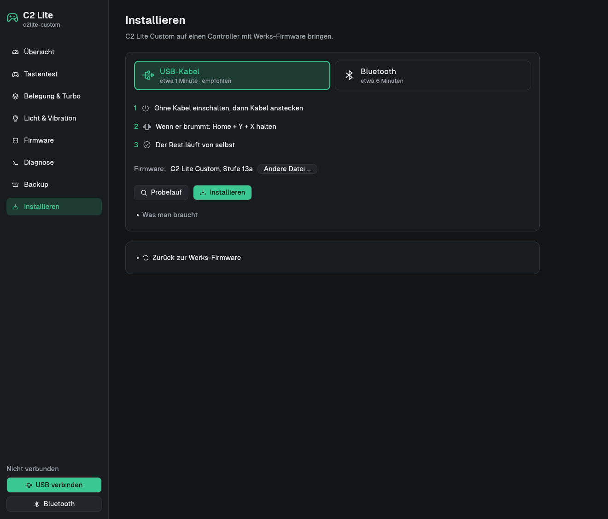
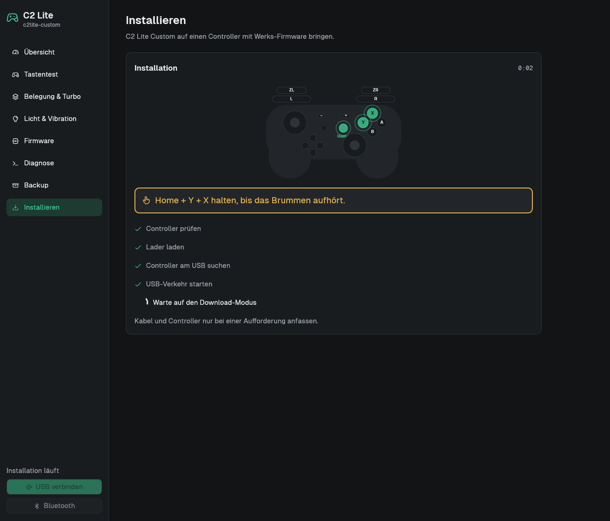
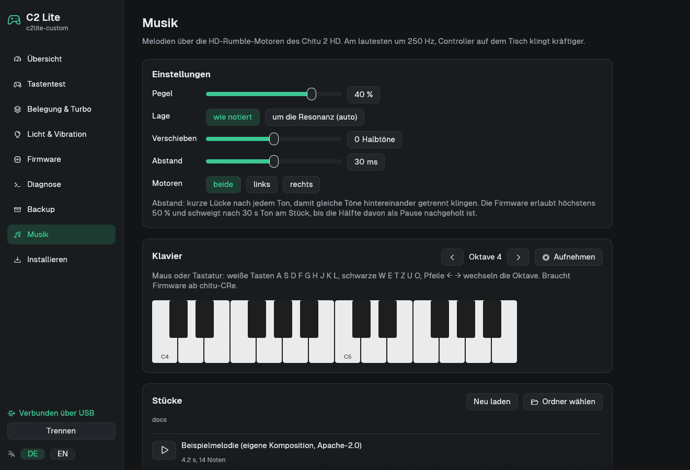

# C2 Lite Custom

Eigene Firmware für den Mobapad C2 Lite (Jieli BR23) und das Programm `c2lite-custom` zum Installieren und Einstellen.

English version: [`README.en.md`](README.en.md)

## Warum

Mit der Werks-Firmware lief der Controller unter Linux weder per USB (Firmware-Fehler, nur mit dem Kernel-Parameter
`usbcore.quirks=2345:e06e:i`) noch per Bluetooth (Kopplung wird abgelehnt). An der Switch 2 meldet er sich als alter
Switch-1-Controller und kann die Konsole nicht wecken.

Mit dieser Firmware:

- PC: als Xbox-Controller mit Vibration, per USB und per Bluetooth LE
- Switch 2: per Bluetooth als Pro Controller 2; Home weckt die Konsole, im Standby geht der Controller nach 30 s aus
- Switch kabelgebunden als Pro Controller
- Rücktasten, Turbo, Makros, Licht, Auto-Aus wie bisher, eingestellt über `c2lite-custom` statt die App
- Updates per USB oder Bluetooth

## So sieht `c2lite-custom` aus

Das Programm gibt es auf Deutsch und Englisch (Umschalter DE/EN unten links; es startet in der Systemsprache,
`C2LITE_SPRACHE=de` oder `en` legt sie fest).

| | |
|---|---|
|  |  |
| Übersicht (Seriennummer und Adresse entfernt) | Tastentest |
|  |  |
| Belegung & Turbo | Licht & Vibration |
|  |  |
| Installieren (USB-Kabel oder Bluetooth) | Installieren: Home + Y + X halten |

## Installieren (Linux)

Voraussetzungen: Linux auf x86_64, ein USB-Datenkabel, Internet für den ersten Lauf und `c2lite-custom`: fertig unter
[Releases](https://github.com/dazi-web/mobapad-c2lite/releases) (glibc ≥ 2.31, z. B. Debian 11, Ubuntu 20.04 und neuer)
oder selbst bauen mit `cargo build --release` in [`c2lite-custom/`](c2lite-custom/). Die Firmware
[`release/jl_isd.bin`](release/) ist im Programm eingebaut (Prüfsummen in `release/SHA256SUMS`); eine eigene Datei
lässt sich wählen (selbst bauen siehe [`docs/FIRMWARE.md`](docs/FIRMWARE.md)).

**Über das USB-Kabel (empfohlen, neu seit 31.10.2026):**

1. `c2lite-custom` starten, Seite „Installieren“, Weg „USB-Kabel“ (Firmware: eingebaut).
2. Erst „Probelauf“: öffnet den Download-Modus und sichert den Speicher, schreibt nichts.
3. Controller **ohne Kabel** einschalten (Schieber auf PC, Home), dann das Kabel anstecken.
4. Wenn der Controller leicht brummt: **Home + Y + X** halten, bis das Brummen aufhört (etwa 2 s). Das Programm
   sichert den gesamten Speicher nach `~/c2lite-sicherung/`, schreibt die Firmware, liest sie zurück und startet neu.

Kommandozeile: `c2lite-custom installieren --usb [--probelauf] [eigene-jl_isd.bin]`. Hintergrund:
[`docs/WERKS-DOWNLOAD.md`](docs/WERKS-DOWNLOAD.md).

**Über Bluetooth** (braucht Bluetooth am Rechner; Weg „Bluetooth“):

1. Probelauf: koppelt einmal mit dem Controller, ändert nichts.
2. Installieren: Controller ohne Kabel in den Kopplungsmodus. Das Programm überträgt über den offiziellen Update-Weg
   eine kleine Brücke (4 bis 6 Minuten).
3. Auf Aufforderung das USB-Kabel einstecken. Weiter wie oben.

Danach: Schieber auf PC für den Rechner, auf Switch für die Switch. Ab Firmware-Stufe 14: beim Schieben auf Switch **Minus** halten = Switch 1,
**Plus** = Switch 2 (Logo blinkt 1× bzw. 2× türkis, die Wahl bleibt gespeichert). An der Switch einmal unter
„Griff/Reihenfolge ändern“ koppeln. Die Installation leert den Einstellungsspeicher des Controllers; eine alte
Bluetooth-Kopplung dieses Rechners mit „C2 Lite dazi“ entfernt das Programm deshalb selbst. Für Bluetooth am PC neu koppeln.

Unter Windows ist das Installieren nicht möglich. Der Controller sollte dort als Xbox-Controller ohne Treiber laufen,
getestet ist das nicht.

## Chitu 2 HD (experimentell)

Der Mobapad Chitu 2 HD (per Bluetooth „Mobapad-Pro2-HD“) hat denselben Chip, aber eine andere Platine: die Sticks
liefert ein eigener Baustein, die Vibration kommt aus zwei Linearmotoren am Audio-DAC („HD-Rumble“). Dafür gibt es eine
eigene Bauvariante der Firmware (`sdk-arbeit/chitu-sdk-aenderungen.patch`, fertig in [`release/chitu/`](release/chitu/)).
Die C2-Lite-Firmware passt **nicht** auf das Chitu und umgekehrt; das Programm prüft das vor jedem Schreiben.

Läuft (an einem Gerät getestet):

- PC: Xbox-Controller per USB (Linux ohne Kernel-Parameter) und per Bluetooth LE, alle Tasten, beide Sticks,
  L2/R2 digital (wie die Werks-Firmware)
- Vibration aus Spielen auf beide Linearmotoren (linker Motor 160 Hz, rechter 320 Hz, wie die Werks-Firmware)
- Melodien über die Motoren: `c2lite-custom musik <datei>` oder Seite „Musik“ im Programm (Notenformat unten),
  dort auch ein Klavier (Maus oder Tastatur, mit Aufnahme als Notendatei)
- Updates per USB-Kabel, Rückweg zur Werks-Firmware

Fehlt noch: Switch / Switch 2, Licht (Logo, Spieler-LEDs), Bewegungssensor, NFC. Behoben (Stand chitu-CRf): Neustarts
durch den Watchdog, wenn das Programm Befehle schickte, aber die Ausgabe des Controllers nicht abholte. Startet der
Controller doch einmal neu, sichert das Programm das Protokoll nach `~/.cache/c2lite-custom/`.

Installieren (nur Linux, nur über das USB-Kabel):

```
c2lite-custom installieren release/chitu/jl_isd.bin --usb
```

Kabel abziehen, warten bis das Chitu aus ist, ohne Kabel mit einem kurzen Druck auf Home einschalten, Kabel anstecken.
Wenn es im Takt brummt, Home + Y + X halten, bis das Brummen aufhört. Das Programm sichert den ganzen Speicher nach
`~/c2lite-sicherung/werk-sicherung-*.bin`, erkennt die Platine, schreibt, liest zurück und startet neu.

- Update: `c2lite-custom update release/chitu/db_update_data.bin` (oder Seite „Firmware“)
- Zurück zur Werks-Firmware: `c2lite-custom werk-zurueck ~/c2lite-sicherung/werk-sicherung-<zeit>.bin`
- Rettung ohne Öffnen: Home + Y + X 3 s mit PC am Kabel startet den ROM-Download-Modus; Home 10 s startet neu.
  Startet die Firmware mehrmals hintereinander nicht stabil, wartet sie, statt in einer Schleife neu zu starten
  (diese Bremse ist bisher nur am C2 Lite mit derselben Firmware ausgelöst worden).
- Stecken C2 Lite und Chitu gleichzeitig, fragt das Programm auf der Kommandozeile nach `--port`; in der Oberfläche
  gibt es unten links eine Auswahl.



**Hinweis zu Musik und Vibration:** Lange oder laute Töne belasten die Motoren, die Mechanik und den Akku stärker als
normales Rumble. Die Firmware begrenzt den Pegel (50 %) und die Dauer (30 s am Stück), ob das für jedes Gerät reicht,
ist nicht geprüft. Schäden an Motoren oder Controller sind möglich; Nutzung auf eigene Gefahr.

Notenformat für `musik`: Name + Oktave (`A3`, `C#4`, `H3`) oder Frequenz in Hz, Dauer `:ms`, Pause `P`, Kommentar `#`,
z. B. [`docs/beispiel-melodie.txt`](docs/beispiel-melodie.txt). Am deutlichsten klingt es zwischen etwa 250 und 700 Hz,
den Controller auf den Tisch legen.

## Risiken

Beim Firmware-Tausch kann der Controller unbrauchbar werden. Das ist während der Entwicklung einmal passiert.
Vorkehrungen:

- Vor dem ersten Schreiben wird der komplette Speicher gesichert. Damit geht es zurück zur Werks-Firmware
  (Seite „Installieren“, „Zurück zur Werks-Firmware“; am Gerät getestet).
- Alles Geschriebene wird zurückgelesen und verglichen; heruntergeladene Dateien werden per Prüfsumme kontrolliert.
- Updates landen in der zweiten Speicherbank. Bricht ein Update ab, startet die alte Firmware.
- Der Chip hat einen Lademodus im ROM, den keine Firmware überschreiben kann. Mit dieser Firmware: Home und Minus 5 s
  halten, USB-Kabel gesteckt.
- Startet gar nichts mehr, hilft nur ein ESP32-C6 als Rettungssender ([`c6-rettung/`](c6-rettung/)); dafür muss der
  Controller geöffnet werden.

Beim Schreiben das Kabel nicht ziehen und den Controller nicht ausschalten. Die Sicherung aus `~/c2lite-sicherung/`
aufheben, sie passt nur zu diesem einen Controller. Die Garantie ist danach vermutlich weg. Nutzung auf eigenes Risiko.

## Entstehung

Das Projekt ist in wenigen Tagen zusammen mit Claude (Anthropic, über Claude Code) als Co-Autor entstanden. Getestet wurde an einem
Controller und einer Switch 2. Code lesen, bevor man ihm vertraut; Fehler gern melden.

## Quellcode und Lizenz

Eigener Code (Firmware-Module, SDK-Änderungen, `c2lite-custom`, Werkzeuge): Apache-2.0, siehe [`LICENSE`](LICENSE).
Die Firmware baut auf dem öffentlichen [Jieli-SDK](https://github.com/Jieli-Tech/fw-AC63_BT_SDK) auf (ebenfalls
Apache-2.0); den Bluetooth-Stack liefert Jieli nur vorkompiliert. Mobapad-Firmware ist nicht im Repo, die Werkzeuge
laden sie bei Bedarf vom Mobapad-Server. Schriften in `c2lite-custom/assets/fonts/`: Geist, SIL Open Font License.
Die Bluetooth-Berichtsbeschreibung des Xbox Wireless Controller stammt aus
[ESP32-BLE-CompositeHID](https://github.com/Mystfit/ESP32-BLE-CompositeHID) (MIT, © lemmingDev und Mitwirkende).

## Dokumentation

- [`docs/FIRMWARE.md`](docs/FIRMWARE.md): Funktionen, Bedienung, Bauen, Befehle ([English](docs/FIRMWARE.en.md))
- [`docs/PRO-CONTROLLER-2.md`](docs/PRO-CONTROLLER-2.md): Switch 2 als Pro Controller 2 und was man dafür wissen muss
  ([English](docs/PRO-CONTROLLER-2.en.md))
- [`docs/WERKS-DOWNLOAD.md`](docs/WERKS-DOWNLOAD.md): USB-Download-Modus der Werks-Firmware (Home + Y + X), ohne
  Bluetooth-Brücke und ohne ESP32 ([English](docs/WERKS-DOWNLOAD.en.md))

Ordner: `c2lite-custom/` Programm, `sdk-arbeit/sdk-aenderungen.patch` Firmware (Änderungen am Jieli-SDK),
`sdk-arbeit/chitu-sdk-aenderungen.patch` dasselbe für das Chitu 2 HD, `release/` fertige Firmware (`release/chitu/`
fürs Chitu), `werkzeuge/` Bauen, Packen, Download-Modus, `c6-rettung/` Rettungssender.

Danke an [kagaimiq](https://github.com/kagaimiq) (jl-uboot-tool und Jieli-Doku),
[ndeadly](https://github.com/ndeadly/switch2_controller_research) (Switch-2-Protokoll) und die in
[`docs/PRO-CONTROLLER-2.md`](docs/PRO-CONTROLLER-2.md) genannten ESP32-Projekte.
